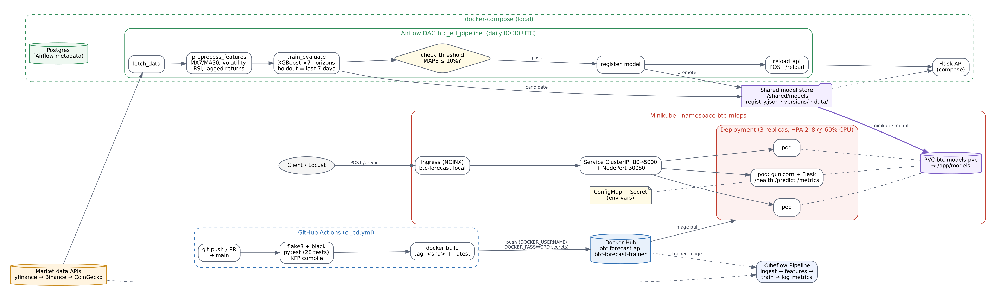

# BTC 7-Day Forecast: Production MLOps Pipeline

MLOps Assignment 3: Flask microservice, Docker, GitHub Actions CI/CD, Airflow ETL,
Kubeflow Pipelines and Kubernetes (Minikube) deployment for forecasting the Bitcoin
(BTC-USD) closing price for the next 7 days.



## How it works

| Stage | What happens |
|---|---|
| **Extract** (`src/etl_fetch.py`) | Pulls ~1500 days of daily OHLCV. Tries yfinance, then Binance, then CoinGecko, so one provider outage doesn't break the run. Drops today's unfinished candle and fills calendar gaps. |
| **Transform** (`src/features.py`) | Lagged log returns, 5/14/30-day returns, MA7 and MA30 ratios, 7/30-day volatility, RSI-14, and 7 targets `log(close[t+h]/close[t])`. Close-only features, so the API can accept a plain price list. |
| **Train** (`src/train_forecast.py`) | One XGBoost regressor per horizon (direct multi-horizon). Evaluated on the **latest 7-day window** it never saw (MAE, RMSE, MAPE plus a naive baseline), then refit on all data. |
| **Register** (`src/model_registry.py`) | File-based registry on the shared volume/PVC. Atomic writes, version history, promotion only when MAPE ≤ threshold (default 10%). Models are saved as native XGBoost JSON plus metadata (no pickle). |
| **Serve** (`app/app.py`) | Flask + Gunicorn. Every worker hot-reloads when the registry pointer changes, so one retrain updates every pod that shares the PVC. |

## Repository layout

```
app/app.py                  Flask API: /health, /predict, /metrics, /reload
app/gunicorn.conf.py        Gunicorn production settings
app/Dockerfile              Multi-stage, non-root, python:3.10-slim API image
src/                        ETL, features, training, registry, bootstrap (+ trainer Dockerfile)
dags/btc_etl_pipeline.py    Airflow DAG (daily ETL, retrain, gate, register, reload)
kubeflow/btc_kfp_pipeline.py   KFP v2 pipeline (container components) -> btc_kfp_pipeline.yaml
airflow/Dockerfile          Airflow 2.10 image with the ML dependencies
docker-compose.yml          API + Airflow + Postgres for local integration testing
.github/workflows/ci_cd.yml Lint, test, build, push to Docker Hub (tags: commit SHA + latest)
k8s/                        Namespace, ConfigMap/Secret, PV/PVC, Deployment, Services, HPA, Ingress
loadtest/                   Locust file + in-cluster load Job
scripts/                    deploy, smoke test, load test, chaos test, end-to-end verification
tests/                      28 pytest tests (API, pipeline, data sources), all offline
docs/RUNBOOK.md             Exact commands to run everything and capture report evidence
```

## API

```bash
curl http://btc-forecast.local/health
curl -X POST http://btc-forecast.local/predict -H "Content-Type: application/json" -d '{"forecast_days": 7}'
# custom history: at least 45 closing prices, optional last_date for the date labels
curl -X POST http://btc-forecast.local/predict -H "Content-Type: application/json" \
     -d '{"history": [95000.1, 95321.4, ...], "last_date": "2026-11-23"}'
curl http://btc-forecast.local/metrics
curl -X POST http://btc-forecast.local/reload -H "X-API-Token: <API_TOKEN>"
```

Errors come back as JSON with the matching status: `400` invalid input, `401` bad token,
`404/405` wrong route or method, `415` non-JSON body, `503` no model yet, `500` unexpected.

## Quick start

```bash
pip install -r requirements.txt -r requirements-dev.txt
pytest                                    # 28 tests, no network needed
cp .env.example .env && docker compose up -d --build
```

Full walkthrough (Minikube, HPA load test, chaos test, end-to-end check): **[docs/RUNBOOK.md](docs/RUNBOOK.md)**.
